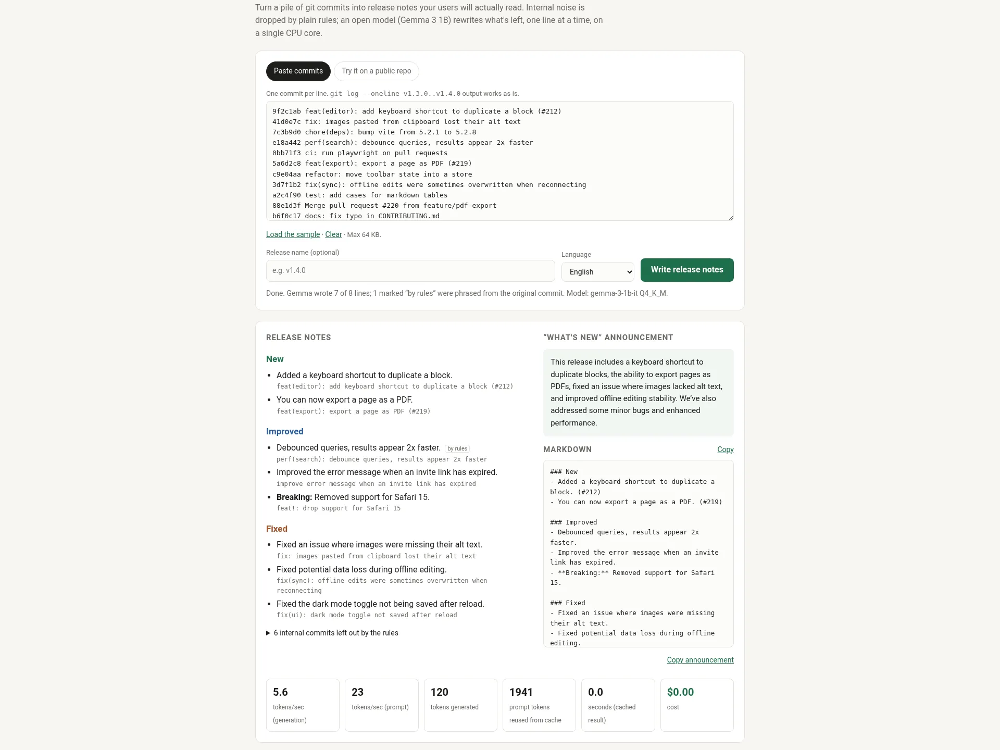

# ShipNotes

**Release notes your users can read, written by a 1B open model on a $5 server.**

ShipNotes takes a list of git commits and gives you back:

- a Markdown changelog grouped into **New / Improved / Fixed**, in plain English (or Simplified Chinese)
- a short **"What's new"** announcement you can paste into a tweet or the first line of an email
- a list of the commits it left out, and why

Live demo: <https://shipnotes.23-95-112-86.sslip.io>



It runs [Gemma 3 1B](https://huggingface.co/google/gemma-3-1b-it) (open weights, Q4_K_M GGUF) through [llama.cpp](https://github.com/ggml-org/llama.cpp) on one CPU thread. There is no API key, no per-token bill, and commit messages from private repos never leave the machine.

## How it works

The trick to making a 1B model reliable is to give it as little to decide as possible.

```
commits ──► parse ──► rules: drop internal ──► rules: pick section ──► Gemma: rewrite ONE line ──► guards ──► Markdown
                         (chore, ci, deps,       (New / Improved /      (prompt prefix is cached,     (kept literal
                          tests, merges, bots)    Fixed, breaking)       first word is prefilled)       tokens, no fluff)
```

1. **Parse.** Accepts `git log --oneline`, plain lists, bullet lists, or full `git log` output. Or fetch a range from a public GitHub repo (`/compare/{base}...{head}`).
2. **Filter, in code.** Conventional-commit types `chore`, `ci`, `build`, `refactor`, `test`, `style`, `docs` and the `deps` scope are dropped. For repos that don't use conventional commits, regex rules catch merges, version bumps, Dependabot/Renovate, lint/format/typo fixes, test and CI changes. Breaking changes (`feat!:` or `BREAKING CHANGE`) are always kept. The model never sees what was dropped.
3. **Classify, in code.** Conventional types map to sections directly; otherwise the first verb decides (`add` → New, `fix` → Fixed, `improve`/`make` → Improved).
4. **Rewrite, one commit at a time.** Gemma gets a fixed few-shot prompt plus one commit. Because the prefix never changes, llama.cpp reuses its KV cache and only the ~15 new tokens are processed. The model's answer is **prefilled** with the first word the rules chose ("Fixed", "Added", "You can now", "Removed"), so a fix can't come out sounding like a feature.
5. **Guard.** If the model drops a literal token from the commit (a `--flag`, `code`, `Class.method`, a number like `3x`), the line falls back to a rule-based rewrite. Filler words ("critical", ", ensuring a seamless…") are cut. Lines marked `rules` in the UI were written without the model.
6. **Announce.** One last call turns the finished bullets into a two-sentence "What's new".

Classification and grouping are deterministic and covered by unit tests. The model only does what small models are good at: rephrasing a short sentence.

## Measured performance

On a shared 1 vCPU VPS (Intel Xeon Gold 5220R, AVX-512), llama.cpp b11716, `-t 1 -c 2048`:

| | |
|---|---|
| Generation speed | ~5.5 tokens/sec |
| Prompt processing | ~22–27 tokens/sec (but ~95% of each prompt is served from cache) |
| Per commit | ~2.5 s |
| 14-commit sample (8 kept) | ~40 s end to end |
| llama-server memory | ~0.95 GB RSS |
| Web app memory | ~25 MB RSS |
| Cost per run | $0.00 |

It is not fast. It doesn't need to be: you write release notes once per release, and the UI streams each line as it's written.

## Run it yourself

Requirements: Linux x86_64, Python 3.10+, ~1.2 GB free RAM, ~1 GB disk. No pip packages: the server is standard library only.

```bash
git clone https://github.com/<you>/shipnotes && cd shipnotes
sudo bash deploy/install.sh        # downloads llama.cpp + Gemma 3 1B, installs two systemd units
curl -s localhost:8411/api/health
```

Or by hand:

```bash
# 1. model server
llama-server -m gemma-3-1b-it-Q4_K_M.gguf -c 2048 -t 1 -np 1 --swa-full --port 8412
# 2. app
SHIPNOTES_LLM_URL=http://127.0.0.1:8412 python3 -m shipnotes.server   # http://127.0.0.1:8411
```

`--swa-full` matters: Gemma 3 uses sliding-window attention, and without a full-size SWA cache llama.cpp can't reuse the prompt prefix, which makes every call ~4x slower.

For HTTPS, adapt `deploy/nginx-shipnotes.conf` (it includes `limit_req` rate limits and a 64 KB body cap) and get a certificate with certbot.

### Configuration

| Variable | Default | |
|---|---|---|
| `SHIPNOTES_PORT` | `8411` | web app port |
| `SHIPNOTES_LLM_URL` | `http://127.0.0.1:8412` | llama.cpp server |
| `SHIPNOTES_MAX_REWRITES` | `15` | commits per request sent to the model; the rest use rules |
| `SHIPNOTES_MAX_COMMITS` | `300` | commits parsed per request |
| `SHIPNOTES_MAX_BODY` | `65536` | request size cap in bytes |
| `GITHUB_TOKEN` | unset | optional; raises the GitHub API limit from 60 to 5,000 requests/hour |

### API

```bash
curl -N https://shipnotes.23-95-112-86.sslip.io/api/notes \
  -d '{"mode":"text","lang":"en","title":"v1.4.0","text":"feat: export to PDF\nfix: crash on resize\nchore: bump deps"}'

curl -N .../api/notes -d '{"mode":"repo","repo":"https://github.com/owner/repo","from":"v1.2.0","to":"v1.3.0","lang":"zh"}'
```

The response is NDJSON: `plan`, then one `item` per note, then `summary`, then `done` with the Markdown and timing stats.

### Tests

```bash
python3 -m unittest discover -s tests -t .
```

## Limits, honestly

- One request at a time. Others wait in a short queue; a fifth waiting request is turned away.
- The model rewrites up to 15 commits per request. Longer ranges still get every line, the rest phrased by rules.
- GitHub's compare API returns at most 250 commits, and anonymous use is limited to 60 requests/hour per server.
- A 1B model sometimes flattens a precise commit into something vaguer. The guards catch the worst of it; always read your notes before you ship them.
- Chinese output is noticeably weaker than English.

## License

MIT
